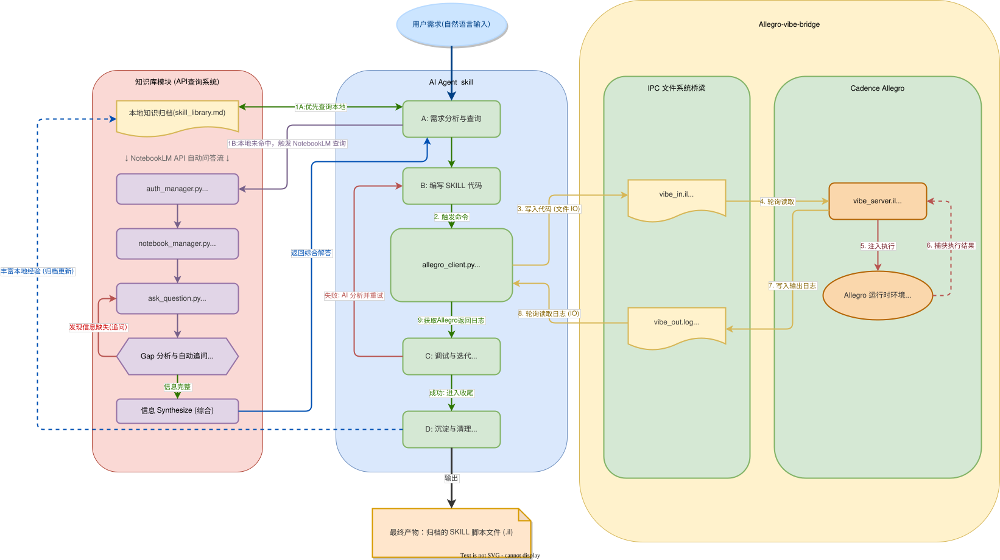
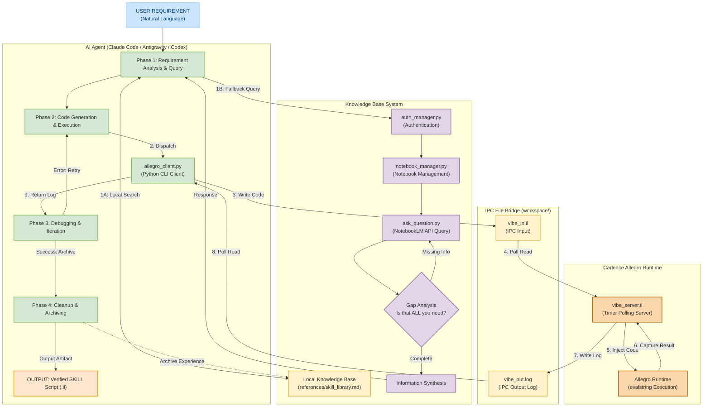

# Allegro Vibe Bridge

English | [简体中文](./README_zh.md)

An interactive, non-blocking Vibe Coding bridge system for Cadence Allegro PCB and AI agents (e.g., Claude Code, Antigravity, Codex).

It enables developers and AI agents to write SKILL code in modern IDEs and execute it in real time within an active Cadence Allegro session.

> **Note**: If you are an AI agent, please refer to [`SKILL.md`](./SKILL.md) for workflow instructions. This document is intended for human users.

---

## Table of Contents

- [Architecture](#architecture)
- [Directory Structure](#directory-structure)
- [Knowledge Base Setup](#knowledge-base-setup)
- [Quick Start](#quick-start)
- [Usage Modes](#usage-modes)
- [Troubleshooting & Best Practices](#troubleshooting--best-practices)
- [Notes & Requirements](#notes--requirements)

---

## Architecture

`Allegro Vibe Bridge` consists of four primary subsystems:
1. **Knowledge Base Module**: Local SKILL library and NotebookLM API integration for API exploration.
2. **AI Agent Skill Flow**: Contextual analysis, code generation, execution triggering, result validation, and experience archiving.
3. **IPC File Bridge**: Asynchronous file-based IPC using `workspace/vibe_in.il` and `workspace/vibe_out.log`.
4. **Cadence Allegro Server**: Silent timer polling service executing code via `evalstring` in the Allegro runtime.



*(Source file available at [allegro_vibe_framework.drawio](./allegro_vibe_framework.drawio))*

<details>
<summary>Click to view interactive Mermaid architecture diagram</summary>



</details>

---

## Directory Structure

| File / Directory | Description |
| ---------------- | ----------- |
| `vibe_server.il` | Allegro-side core server script (starts background timer polling upon loading). |
| `allegro_client.py` | IDE-side Python client for dispatching SKILL code and capturing execution logs. |
| `allegro_vibe_framework.drawio` | Architecture and workflow flowchart source file. |
| `allegro_vibe_framework.svg` | Exported vector diagram for architecture preview. |
| `SKILL.md` | AI Agent workflow definition file. |
| `references/` | SKILL function knowledge base maintained by AI agents. |
| `workspace/` | Generated IPC temporary directory (`vibe_in.il` and `vibe_out.log`). |
| `temp/` | Temporary directory for `.il` scripts generated during development. |
| `archive/` | Storage directory for verified SKILL scripts. |

---

## Knowledge Base Setup

AI agents can query the SKILL API knowledge base via [notebooklm-skill](https://github.com/PleasePrompto/notebooklm-skill) to obtain accurate function signatures, parameter descriptions, and code examples.

### Setup Instructions
1. Obtain Cadence SKILL documentation (e.g., *SKILL Language User Guide*, *Allegro SKILL API Reference*).
2. Upload the documentation to [Google NotebookLM](https://notebooklm.google.com/).
3. Create a notebook named `allegro-skill-programming-guide`.

---

## Quick Start

### Prerequisites

- **Python 3.7+** (Python 2 is not supported).
- **Cadence Allegro 17.4** running with a target board design open.

### Step 1: Start Allegro Server

In the Cadence Allegro Command window, enter:

```skill
skill load("<YOUR_PROJECT_PATH>/vibe_server.il")
```

When `Vibe Polling Server started successfully.` appears, the server is running silently in the background.

*To stop the server at any time, run in Allegro:* `axlUIWTimerRemove(vibeTimerId)`

### Step 2: Dispatch Code from IDE Terminal

Navigate to the project directory:

```bash
cd "<YOUR_PROJECT_PATH>"
```

---

## Usage Modes

### Mode A: Interactive REPL (Single Commands)

```bash
python allegro_client.py
```

Enter any expression (e.g., `result = 100 + 200`) and press Enter. Type `exit` to quit.

### Mode B: Inline Single Line Command

```bash
python allegro_client.py "axlVersion()"
```

> **Note for Windows users**: Avoid complex double-quoted strings in inline mode as command-line shells may unescape quotes. Use Mode C for complex scripts. Simple arguments without quotes can be passed directly (e.g., `python allegro_client.py 1+1`).

### Mode C: Script File Execution (Recommended for Complex Logic)

Write code in a standalone `.il` file in the `temp/` directory, then execute with `-f`:

```bash
python allegro_client.py -f temp/my_script.il
```

> **Workflow Tip**: Edit `temp/my_script.il` in your IDE, save the file, and rerun the command in the terminal to view results in Allegro instantly.

---

## Troubleshooting & Best Practices

### Rule 1: Do Not Use Semicolon (`;`) Comments in File Mode

The bridge server concatenates code lines using `strcat`. Semicolon (`;`) comments can cause trailing code to be ignored.

```skill
;; Incorrect: Semicolon comments in file mode may swallow subsequent code
;; etch_layers = axlSubclassRoute()

;; Correct: Omit semicolon comments in file mode scripts
etch_layers = axlSubclassRoute()
```

### Rule 2: Use REPL for Fast Queries

```bash
python allegro_client.py "axlMKSConvert(axlCNSGetSpacing(\"\" \"TOP\" 'line_line) \"design\" \"MILS\")"
```

Executing single queries via REPL is faster than creating, running, and deleting file scripts.

### Rule 3: Understanding Return Values

Bridge output format:
```text
SUCCESS
<value>
```

- `<value>` is formatted using SKILL `%L`. `nil` is returned as literal `nil`.
- If `t` is returned when a number was expected, the function returns a boolean indicator (e.g., constraint existence) rather than the metric value.
- `printf` output goes to the Allegro Command Window, **not** back to the bridge client (only the last evaluated expression value is returned).

### Rule 4: Unit Conversion

```skill
value_mils = axlMKSConvert(raw_value "design" "MILS")
value_mm   = axlMKSConvert(raw_value "design" "MILLIMETERS")
```

Functions such as `axlCNSGetSpacing` return design units (DBU). Convert values explicitly using `axlMKSConvert`.

### Quick Diagnostic Reference

| Symptom | Cause | Solution |
| ------- | ----- | -------- |
| File mode returns `nil` | Semicolon `;` comments present in `.il` file | Remove all semicolon comments from file. |
| Returns `t` instead of numerical value | Function returns boolean status | Pass `nil` parameter to inspect full constraint structure. |
| `printf` output missing in terminal | Output directed to Allegro window | Ensure the final line of the script evaluates to the desired return value. |
| REPL syntax error on strings | Shell quote parsing issue on Windows | Use file mode (`-f`) or escape inner quotes (`\"`). |
| Returned number has unknown unit | Unspecified design units | Use `axlMKSConvert` to explicitly convert to `MILS` or `MILLIMETERS`. |

---

## Notes & Requirements

1. **Return Values**: To transmit data back to the IDE client, ensure the variable or expression to return is placed on the **last line** of the executed SKILL code block.
2. **Error Handling**: Syntax errors and runtime exceptions in SKILL code are redirected via `errport` and printed in red directly in the terminal (e.g., `*Error* eval: undefined function`). Non-fatal warnings remain in the Allegro Command Window.
3. **Stopping Polling**: To stop the Allegro background server, execute `axlUIWTimerRemove(vibeTimerId)` in the Allegro Command Window.
