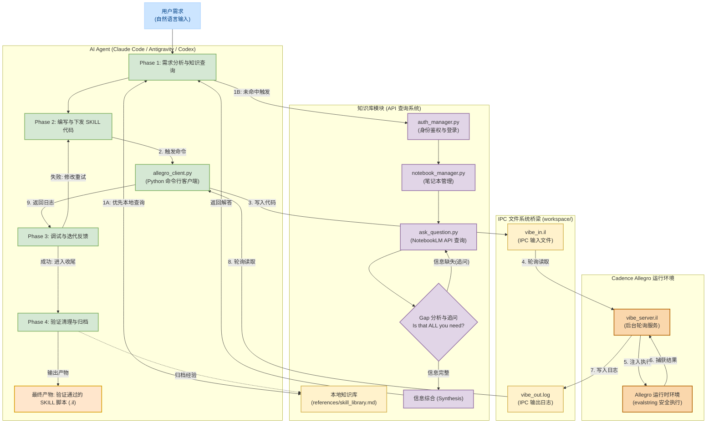

# Allegro Vibe Bridge

[English](./README.md) | 简体中文

专为 Cadence Allegro PCB 与 AI Agent（如 Claude Code、Antigravity、Codex 等）打造的轻量级、无阻塞 Vibe Coding 桥接系统。

开发者与 AI Agent 可以在现代 IDE 中编写 SKILL 代码，并实时在运行中的 Cadence Allegro 会话中执行与查看结果。

> **注意**：如果您是 AI Agent，请参阅 [`SKILL.md`](./SKILL.md) 获取工作流定义文件。本文档面向人类用户。

---

## 目录

- [系统架构](#系统架构)
- [目录结构](#目录结构)
- [知识库配置](#知识库配置)
- [快速开始](#快速开始)
- [运行模式](#运行模式)
- [排错与最佳实践](#排错与最佳实践)
- [注意事项](#注意事项)

---

## 系统架构

`Allegro Vibe Bridge` 由以下四个主要子系统构成：
1. **知识库模块**：本地 SKILL 函数库与 NotebookLM API 查询集成，用于探索 API 用法。
2. **AI Agent 工作流**：上下文分析、代码下发、执行触发、结果校验与经验归档。
3. **IPC 文件系统桥梁**：基于 `workspace/vibe_in.il` 与 `workspace/vibe_out.log` 的异步文件通信。
4. **Cadence Allegro 服务端**：在 Allegro 运行时中静默轮询并使用 `evalstring` 安全执行代码的定时器服务。


*(流程图源文件参见 [allegro_vibe_framework.drawio](./allegro_vibe_framework.drawio))*

<details>
<summary>点击展开 Mermaid 交互式架构流程图</summary>



</details>

---

## 目录结构

| 文件 / 目录 | 说明 |
| ----------- | ---- |
| `vibe_server.il` | Allegro 端核心服务脚本（加载后自动启动后台定时轮询）。 |
| `allegro_client.py` | IDE 端 Python 客户端，负责发送代码和抓取执行日志。 |
| `allegro_vibe_framework.drawio` | 系统架构与工作流 Draw.io 流程图源文件。 |
| `allegro_vibe_framework.svg` | 系统架构矢量预览图。 |
| `SKILL.md` | AI Agent 的工作流定义文件。 |
| `README.md` | 英文版项目说明文档。 |
| `README_zh.md` | 中文版项目说明文档。 |
| `references/` | AI Agent 维护的 SKILL 函数知识库目录。 |
| `workspace/` | 自动生成的 IPC 临时通信目录（包含 `vibe_in.il` 和 `vibe_out.log`）。 |
| `temp/` | 存放开发过程中生成的临时 `.il` 脚本，任务完成后清理。 |
| `archive/` | 存放验证通过的 SKILL 脚本归档。 |

---

## 知识库配置（可选但推荐）

AI Agent 可通过 [notebooklm-skill](https://github.com/PleasePrompto/notebooklm-skill) 查询 NotebookLM 知识库，获取准确的 SKILL API 函数签名、参数说明与代码范例。

### 创建步骤
1. 获取 Cadence SKILL 相关官方文档（如 *SKILL Language User Guide*、*Allegro SKILL API Reference* 等）。
2. 将文档上传至 [Google NotebookLM](https://notebooklm.google.com/)。
3. 创建名为 `allegro-skill-programming-guide` 的笔记本即可。

---

## 快速开始

### 前置要求

- **Python 3.7+**（客户端脚本不兼容 Python 2）。
- **Cadence Allegro 17.4** 处于运行状态并已打开目标设计文件 (Board Design)。

### 步骤 1：启动 Allegro 服务端

在 Cadence Allegro 命令窗口 (Command Window) 中输入：

```skill
skill load("<YOUR_PROJECT_PATH>/vibe_server.il")
```

显示 `Vibe Polling Server started successfully.` 即表示服务端已在后台静默轮询。

*如需随时停止服务端轮询，在 Allegro 中执行：* `axlUIWTimerRemove(vibeTimerId)`

### 步骤 2：在 IDE 终端中发送代码

进入项目根目录：

```bash
cd "<YOUR_PROJECT_PATH>"
```

---

## 运行模式

### 模式 A：交互式 REPL（适用于单行测试）

```bash
python allegro_client.py
```

进入终端后输入任意表达式（例如 `result = 100 + 200`）按回车即可查看结果。输入 `exit` 退出。

### 模式 B：单行指令模式（适用于快速查询）

```bash
python allegro_client.py "axlVersion()"
```

> **Windows 用户提示**：单行模式中应避免使用带双引号的复杂字符串，命令行解析可能破坏引号导致语法错误。复杂逻辑请使用模式 C。不带引号的简单参数无需额外包裹，例如 `python allegro_client.py 1+1`。

### 模式 C：执行 SKILL 脚本文件（推荐用于多步逻辑）

将 SKILL 代码保存在 `temp/` 目录下的 `.il` 文件中，使用 `-f` 参数执行：

```bash
python allegro_client.py -f temp/my_script.il
```

> **工作流技巧**：在 IDE 编辑器中编写并保存 `temp/my_script.il`，在终端按 ↑ 回车即可立刻在 Allegro 中看到运行结果。

---

## 排错与最佳实践

### 规则 1：文件模式中切勿使用分号 (`;`) 注释

Bridge 服务端使用 `strcat` 拼接代码行，分号 (`;`) 注释可能导致后续代码被吞掉。

```skill
;; 错误示例：文件模式中的分号注释可能导致后续代码失效
;; etch_layers = axlSubclassRoute()

;; 正确示例：文件模式脚本中避免添加分号注释
etch_layers = axlSubclassRoute()
```

### 规则 2：简单查询优先使用 REPL

```bash
python allegro_client.py "axlMKSConvert(axlCNSGetSpacing(\"\" \"TOP\" 'line_line) \"design\" \"MILS\")"
```

通过 REPL 进行单条查询比创建、运行和删除临时文件脚本更加高效。

### 规则 3：理解返回值约定

Bridge 的终端输出格式：
```text
SUCCESS
<value>
```

- `<value>` 使用 SKILL `%L` 格式化，`nil` 将显示为字面量 `nil`。
- 若预期返回数值但实际返回了 `t`，说明该函数在该上下文返回的是布尔状态（如约束是否存在）而非具体数值。
- `printf` 的打印输出会进入 Allegro 命令窗口，**不会**回传给客户端（仅代码块最后一行的表达式值会被回传）。

### 规则 4：单位转换

```skill
value_mils = axlMKSConvert(raw_value "design" "MILS")
value_mm   = axlMKSConvert(raw_value "design" "MILLIMETERS")
```

如 `axlCNSGetSpacing` 等函数返回值为设计单位 (DBU)，请使用 `axlMKSConvert` 进行显式单位转换。

### 常见问题速查表

| 症状 | 原因 | 解决办法 |
| ---- | ---- | -------- |
| 文件模式执行返回 `nil` | `.il` 文件中包含分号 `;` 注释 | 删除脚本文件中的所有分号注释。 |
| 返回 `t` 但期望数值 | 函数返回布尔状态 | 传入 `nil` 参数查询完整数据结构。 |
| 终端看不到 `printf` 调试信息 | 调试信息输出到了 Allegro 窗口 | 确保脚本最后一行计算并返回目标变量。 |
| REPL 模式报字符串语法错误 | Windows 命令行引号解析问题 | 使用文件模式 (`-f`) 或转义内部双引号 (`\"`)。 |
| 返回数值但不知单位 | 设计单位未明确 | 使用 `axlMKSConvert` 显式转换为 `MILS` 或 `MILLIMETERS`。 |

---

## 注意事项

1. **结果回传**：在 SKILL 代码中，请确保将欲回传的变量或表达式放在代码块的**最后一行**。
2. **错误捕捉**：若 SKILL 代码存在语法错误或运行时异常，`vibe_server` 将重定向 `errport` 并直接在终端用红色打印原汁原味的报错信息（如 `*Error* eval: undefined function`）。非致命 WARNING 仍保留在 Allegro 命令窗口。
3. **停止服务**：若需停止 Allegro 端后台轮询，在 Allegro 命令窗口中执行 `axlUIWTimerRemove(vibeTimerId)` 即可。
